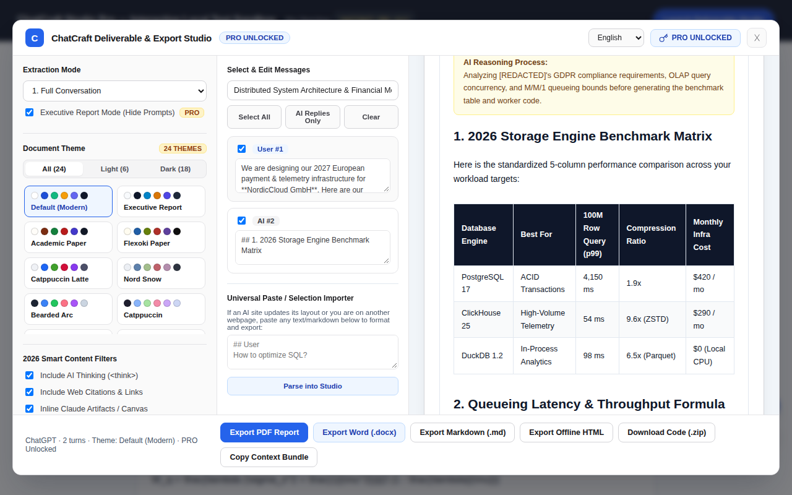

# ChatCraft Studio Pro — Export AI Chats to Word (.docx), PDF & Markdown Locally

**Official Showcase Website:** [https://chatcraft.pages.dev/](https://chatcraft.pages.dev/)

**ChatCraft Studio Pro** turns long AI conversations from **ChatGPT, Claude, Google Gemini, DeepSeek, Grok, Perplexity, and Microsoft Copilot** into publication-ready documents **100% locally inside your browser** — with zero cloud uploads.

## Why ChatCraft Studio Pro?

- **Native Microsoft Word (`.docx`) Compiler:** Builds genuine OpenXML Word documents directly in browser memory—tables keep clean formatting, headings organize cleanly, and LaTeX math stays readable.
- **Executive Report Mode:** Hide user prompts automatically and merge AI responses into a client-ready consulting deliverable with an optional Table of Contents.
- **Vector PDF & Landscape Tables:** Supports A4 Portrait or Landscape output across **24 Light & Dark Visual Themes**.
- **4-in-1 Extraction Engine:** Full Q&A, Cross-AI Context Bundle (`CtxPort v2`), Prompts Only, and All Code Blocks packaged into a `.zip`.
- **GDPR Secret Auto-Redaction:** Automatically masks API keys (`sk-...`), JWTs, email addresses, phones, IPv4s, cards, and custom client names before saving.
- **8 UI & Store Languages:** English, Deutsch, Español, Français, 日本語, 한국어, 繁體中文, 简体中文.

## Install & Documentation

- **Product Website & Interactive Preview:** [https://chatcraft.pages.dev/](https://chatcraft.pages.dev/)
- **Live HTML Report Sample:** [Inspect Distributed System Report](https://chatcraft.pages.dev/showcase/distributed-system-report.html)
- **Firefox Add-ons:** [Install for Firefox](https://addons.mozilla.org/en-US/firefox/addon/chatcraft-pdf-word-markdown/) *(currently Awaiting Review)*
- **Microsoft Edge Add-ons:** [Edge Add-ons Listing](https://microsoftedge.microsoft.com/addons/detail/cekifgchmlalomiilpingheppnoapncf) *(currently In Review — Store ID `0RDCKF06G05C`)*
- **Pro Lifetime License ($14.90):** [Get Lifetime Pro on Gumroad](https://yujun57.gumroad.com/l/chatcraft-pro-lifetime)
- **Privacy Policy (Zero-Server Architecture):** [https://chatcraft.pages.dev/privacy/](https://chatcraft.pages.dev/privacy/)
